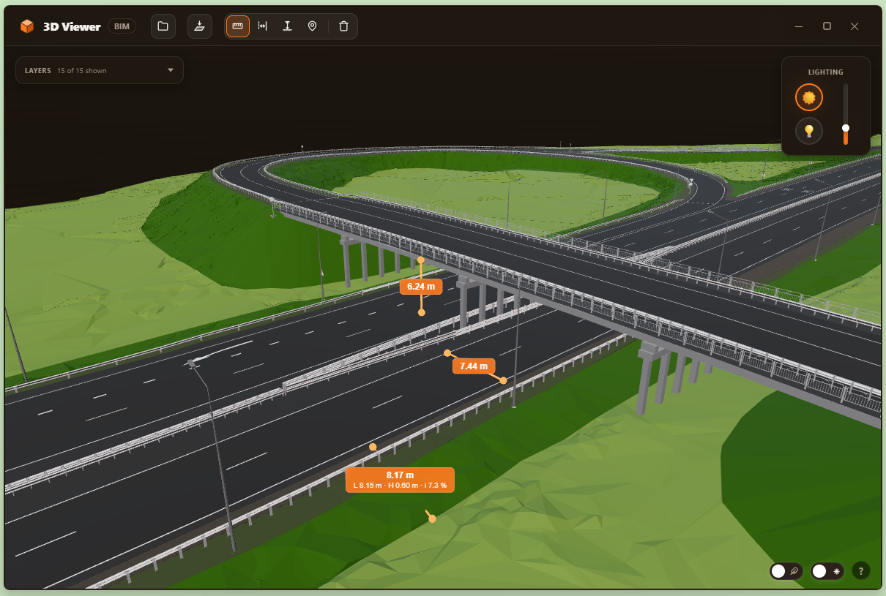

# Road 3D Viewer

A desktop viewer for road BIM models, CAD drawings and point clouds, with measuring tools built for road work: lane width between markings, clearance height, slope and real-world coordinates.



*A motorway interchange (IFC, 15 layers) with three measurements: clearance under the overpass (6.24 m), width between road markings (7.44 m) and a distance with horizontal length, height difference and slope (8.17 m).*

## Why

Road design models (IFC exported from road CAD software), as-built DXF drawings and lidar point clouds usually have to be checked together. General-purpose BIM viewers make that awkward:

- road models sit in projected coordinates with values in the millions, and in single precision the geometry starts to jitter: sign plates fall apart and posts shake;
- a 20 km section with guardrails easily has more than 10 million triangles, and every click becomes slow;
- there is no quick way to answer the questions a road engineer actually asks: how wide is this lane, how high is the sign above the pavement, where exactly is this point on the map.

This viewer opens all of these files in one scene, keeps them aligned, stays responsive on large models and measures what matters on a road.

## Features

**Formats**

- **IFC** (IFC2X3, IFC4, older schemas read as the closest known one). Parsed with IfcOpenShell in double precision and re-centred before going to the GPU, so large coordinates stay exact. Large triangulated surfaces (DTMs) are read directly from the file, 15–25 times faster than through the geometry kernel. Without IfcOpenShell, IFC falls back to web-ifc in the browser.
- **LAS / LAZ** point clouds with RGB colour.
- **DXF**: lines, polylines, arcs, splines, hatches, 3D faces, meshes and ACIS solids (3DSOLID, REGION, BODY), including nested blocks. Each DXF layer can be switched on and off separately.
- **OBJ** with `.mtl` materials and textures.

**Measuring**

- **Distance** between two points, with horizontal distance, height difference and slope in %.
- **Lane width**: click two road markings and the points snap to their centre lines; the width is measured strictly perpendicular to the first line, so it does not depend on how precisely you click.
- **Height**: drops a plumb line from a point (top of a sign, underside of a bridge span) down to the surface below it.
- **Coordinates**: latitude and longitude in WGS 84 for any point, converted from UTM (the zone is selectable), with a copy button.

**Working with large models**

- Several files in one scene, aligned on a shared origin.
- Parsed models are cached next to the source file (`*.3dvcache`), so the second opening takes seconds instead of minutes.
- Large meshes are split into tiles, so picking and culling only touch what is under the cursor.
- Rendering on demand: the GPU is idle when nothing moves.
- Low-power mode for weaker PCs: half resolution while the camera moves, a sharp frame as soon as it stops.
- Heavy files are parsed in a separate process and can be cancelled at any moment without freezing the window.

**Interface**

- Layers panel, top view (north up), daylight and studio lighting, light or dark scene background.
- Mouse: left button drags the scene, right button orbits around the point under the cursor, wheel zooms to the cursor, double click flies to a point.
- Frameless window with native Windows behaviour: snapping, resizing, rounded corners and shadow on Windows 11.

## Quick start

Requires Python 3.9+ and Windows 10/11. The viewer also starts on Linux, but the window chrome is designed for Windows.

```bash
pip install -r requirements.txt
python viewer.py path/to/model.ifc path/to/cloud.laz
```

Files can also be added later with the **Open file** button. To start without a console window, use `pythonw viewer.py`.

### Try it with demo data

`examples/make_demo_data.py` generates a small synthetic scene: a curved two-lane road with markings and signs (IFC) and the surrounding ground as a coloured point cloud (LAZ), both in UTM zone 41N.

```bash
python examples/make_demo_data.py
python viewer.py examples/demo_road.ifc examples/demo_terrain.laz
```

## How it works

```
viewer.py (PyQt6)                          web/ (Three.js)
├─ parses files: IfcOpenShell, laspy,      ├─ index.html: UI, panels, top bar
│  ezdxf -> compact binary streams         ├─ main.bundle.js: scene, camera,
├─ local HTTP server for web/ and models   │  loaders, measuring tools
├─ cache, tiling, cancellable workers      └─ web-ifc: fallback IFC parser
└─ QWebEngineView + QWebChannel  <──────── window.pyBackend (window controls,
                                            file dialog, clipboard)
```

Python does the heavy lifting: it reads each file, converts it to Y-up Three.js axes, subtracts the model centre in double precision and sends a compact binary stream (positions as float32, colours as uint8) to the page. The page keeps a shared scene origin, so models from the same coordinate system line up.

## Project structure

```
viewer.py                 application: window, file parsing, cache, local server
web/
  index.html              interface
  main.bundle.js          built front end (Three.js r149, camera-controls, loaders)
  web-ifc-api-iife.es5.js web-ifc (fallback IFC parser) and its .wasm files
  logo.svg, logo-*.png    app icon
src/main.js               readable source of the front-end logic in main.bundle.js
examples/                 demo data generator
```

`main.bundle.js` is committed prebuilt, so the app runs without Node.js. `src/main.js` is the source of the application part of the bundle.

## Requirements

- PyQt6 and PyQt6-WebEngine
- numpy
- laspy with lazrs (LAS/LAZ)
- ifcopenshell (recommended for IFC; without it IFC goes through web-ifc and large coordinates may jitter)
- ezdxf (DXF)

## Third-party components

The front end bundles [three.js](https://github.com/mrdoob/three.js) (MIT), [camera-controls](https://github.com/yomotsu/camera-controls) (MIT) and [web-ifc-three](https://github.com/ThatOpen/web-ifc-three) (MIT). `web/web-ifc-*` are unmodified files from [web-ifc](https://github.com/ThatOpen/engine_web-ifc) 0.0.39 (MPL-2.0).
